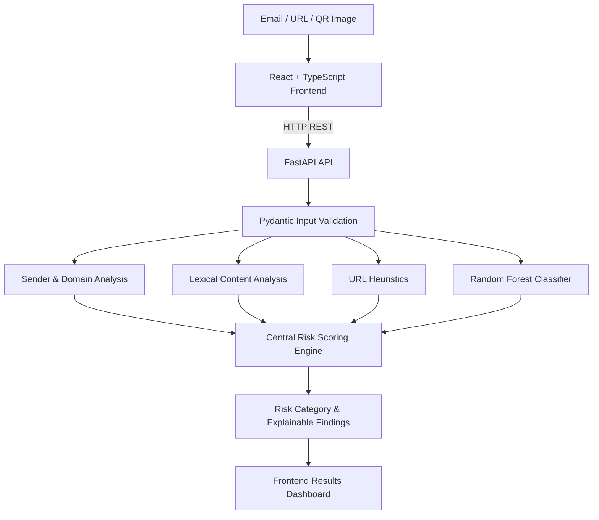

# PhishGuard AI — Offline Hybrid Phishing & Quishing Detection System

[](https://fastapi.tiangolo.com/)
[](https://react.dev/)
[](https://www.typescriptlang.org/)
[](https://vite.dev/)
[](https://scikit-learn.org/)
[](https://www.docker.com/)
[](https://opensource.org/licenses/MIT)

PhishGuard AI is a cybersecurity application designed to identify phishing emails, suspicious URLs, deceptive domains, and QR-code phishing (quishing).

It combines statistical machine learning, deterministic security rules, lexical analysis, and explainable findings to help users understand potential threats.

The system is designed to perform core analysis locally using installed models, rules, and data. External network access is not required for local URL-structure analysis or other detection capabilities that do not explicitly depend on live external services.

> **Important:** Offline analysis cannot guarantee that a website is safe. Detection capabilities depend on the implemented code, available model artifacts, local data, and configuration.

---

## Table of Contents

- [Current Features](#current-features)
- [System Architecture](#system-architecture)
- [AI and Detection Engines](#ai-and-detection-engines)
- [Risk Scoring](#risk-scoring)
- [Technology Stack](#technology-stack)
- [Prerequisites](#prerequisites)
- [Installation and Setup](#installation-and-setup)
- [Dataset Download and Model Training](#dataset-download-and-model-training)
- [Running the Application](#running-the-application)
- [API Documentation](#api-documentation)
- [Testing](#testing)

- [Academic and System Guide](#academic-and-system-guide)
- [License](#license)

---

## Current Features
-Analyze an email using its sender email address, optional Reply-To address, subject, and body.
-Optionally provide URLs and available SPF, DKIM, and DMARC authentication results.
-Evaluate sender details, email content, URLs, and supplied authentication results.
-Use a Random Forest machine-learning detector as part of the analysis.
-Return a risk score, risk category, explainable findings, and recommendations.
-Return an Inconclusive result when the available evidence is insufficient to provide a conclusive assessment.

---

## System Architecture

The application uses a React frontend communicating with a FastAPI backend over HTTP REST.



### Processing Flow

1. The user submits an email, URL, or supported QR-code input.
2. The frontend sends the request to the backend.
3. FastAPI validates the request.
4. Applicable detection engines analyze the input.
5. The risk engine combines the available findings.
6. The API returns a structured response.
7. The frontend displays the risk assessment and recommendations.

---

## AI and Detection Engines

PhishGuard uses a hybrid approach rather than relying exclusively on a machine learning prediction.

### 1. Statistical Machine Learning
**Model:** Random Forest classifier.

The configured model is intended to analyze 14 URL-related features, including:

- URL length and subdomain depth.
- Token and character distributions.
- Digit-to-letter ratios.
- Path entropy.
- IP-address host indicators.

Expected model artifact:

```text
backend/app/models/artifacts/url_rf_model.joblib
```

The model must be trained and serialized before use if the artifact is not already available.

### 2. Lexical and Content Analysis

The content analysis engine examines suspicious wording and social-engineering patterns, including:

- **Temporal pressure:** urgent deadlines and time-limited warnings.
- **Credential coercion:** requests to verify an account or reset a password.
- **Threats:** account suspension warnings and claims of unauthorized activity.

Text normalization can help detect unusual character sequences. However, normalization alone does not guarantee detection of every Unicode homoglyph or adversarial variation.

## Risk Scoring

The documented design proposes limiting the contribution of the machine learning model so that an ML prediction alone cannot trigger a Suspicious verdict.

| Risk category | Intended score range |
|---|---:|
| Low Risk | 0–24 |
| Suspicious | 25–59 |
| High Risk | 60–100 |
| Inconclusive | No numerical score |

The proposed maximum ML contribution is 24 points, while the Suspicious threshold is 25 points.

If the implementation enforces these limits, the ML contribution alone cannot reach the Suspicious threshold. Other scoring inputs and category rules must still be tested.

The reported ML probability threshold of approximately `0.2232` is a separate model-classification setting. It must not be confused with the overall risk score or treated as a verified performance guarantee without supporting evaluation results.

---

## Technology Stack

| Component | Technology | Purpose |
|---|---|---|
| Frontend | React 18 | User interface |
| Language | TypeScript | Type-safe frontend development |
| Build tool | Vite | Development server and production build |
| Backend | FastAPI | HTTP API and request handling |
| Validation | Pydantic | Request and response validation |
| Machine learning | scikit-learn | Model training and inference |
| Model serialization | Joblib | Persisting trained model artifacts |
| Containerization | Docker Compose | Local application deployment |

The exact installed versions and dependencies should be confirmed from the project's package and requirements files.

---

## Prerequisites

Install the following tools for local development:

- Python 3.10, 3.11, or 3.12, compatible with the backend dependencies.
- Node.js 20 LTS or another version supported by the frontend dependencies.
- npm.
- Git.
- Docker Desktop with Docker Compose, if using containers.

Check your installed versions:

```powershell
python --version
node --version
npm --version
docker --version
docker compose version
```

Docker is optional when running the frontend and backend directly.

---

## Installation and Setup

### Step 1 — Clone the Repository

```bash
git clone <YOUR_REPOSITORY_URL>
cd <YOUR_REPOSITORY_DIRECTORY>
```
Replace the placeholders with the actual repository URL and directory name.

### Step 2 — Set Up the Backend
From the repository root, run:

```powershell
cd backend

python -m venv .venv
.\.venv\Scripts\Activate.ps1

python -m pip install --upgrade pip
pip install -r requirements.txt
```

On Linux or macOS, activate the environment using:

```bash
source .venv/bin/activate
```

If PowerShell blocks environment activation, use an appropriate execution-policy setting for your environment or invoke the virtual environment's Python executable directly.

### Step 3 — Check the Model Artifact
From the repository root:

```powershell
Test-Path "backend/app/models/artifacts/url_rf_model.joblib"
```

- **If `True`:** The model artifact exists. Verify that the backend can load it.
- **If `False`:** Follow the dataset and training instructions below.

---

## Dataset Download and Model Training

The raw PhiUSIIL Phishing URL Dataset is excluded from Git because of its size. Developers must download it separately when training the model from scratch.

### Step 1 — Download the Dataset

Download the **PhiUSIIL Phishing URL Dataset** from the [UCI Machine Learning Repository](https://archive.ics.uci.edu/dataset/967/phiusiil+phishing+url+dataset).

1. Open the dataset page.
2. Download the available dataset archive.
3. Extract the archive locally.
4. Locate the actual CSV file inside the extracted contents.

The downloaded archive may use a different filename or directory structure from the path expected by this project.

### Step 2 — Create the Required Directory

From the repository root, run:

```powershell
New-Item -ItemType Directory -Force "backend/data/raw"
```

### Step 3 — Copy the Dataset into the Project

The training workflow expects the following exact path:

```text
backend/data/raw/PhiUSIIL_Phishing_URL_Dataset.csv
```

If the extracted CSV is in your Downloads directory and already has that filename, run:

```powershell
Copy-Item "$HOME\Downloads\PhiUSIIL_Phishing_URL_Dataset.csv" `
  "backend\data\raw\PhiUSIIL_Phishing_URL_Dataset.csv"
```

If the CSV has a different filename, replace the source path with its actual location. The destination filename should match the expected path above.

For example, if the extracted file is named `PhiUSIIL_Phishing_URL_Dataset.csv` inside a nested extraction folder:

```powershell
Copy-Item "$HOME\Downloads\extracted-folder\PhiUSIIL_Phishing_URL_Dataset.csv" `
  "backend\data\raw\PhiUSIIL_Phishing_URL_Dataset.csv"
```

Adjust the example source path to match your extracted files.

### Step 4 — Verify the Dataset

From the repository root:

```powershell
Test-Path "backend/data/raw/PhiUSIIL_Phishing_URL_Dataset.csv"
```

Continue only when the command returns:

```text
True
```

You can inspect the file's size and location with:

```powershell
Get-Item "backend/data/raw/PhiUSIIL_Phishing_URL_Dataset.csv" |
  Select-Object FullName, Length
```

### Step 5 — Prepare the Dataset and Train the Model

From the repository root:

```powershell
cd backend

.\.venv\Scripts\Activate.ps1

python -m app.scripts.prepare_dataset
python -m app.ml.train_url_model
```

The documented workflow expects the scripts to prepare the dataset and train the Random Forest classifier.

Expected model output:

```text
backend/app/models/artifacts/url_rf_model.joblib
```

### Step 6 — Verify the Model Artifact

While still inside the `backend` directory, run:

```powershell
Test-Path "app/models/artifacts/url_rf_model.joblib"
```

The command should return `True` if training generated the expected artifact.

### Step 7 — Run Model Tests

Still inside the `backend` directory:

```powershell
pytest tests/test_ml_detector.py -v
```

**Important:** These commands assume the documented scripts, dataset schema, and test module exist in the repository. If a command fails, inspect the actual script requirements and error message rather than assuming the model was trained successfully.

---

## Running the Application

### Option A — Docker Compose

From the repository root:

```bash
docker compose up --build -d
```

If the Compose configuration maps the documented ports, the application should be available at:

| Component | URL |
|---|---|
| Frontend | http://localhost:3000 |
| Backend API | http://localhost:8000 |
| Interactive API documentation | http://localhost:8000/docs |
| OpenAPI schema | http://localhost:8000/openapi.json |
| System guide | http://localhost:3000/sys_guide |

These URLs depend on the actual Compose service configuration and frontend routing.

Inspect service status and logs:

```bash
docker compose ps
docker compose logs -f
```

Stop the services:

```bash
docker compose down
```

### Option B — Local Development

**Terminal 1 — Backend**

From the repository root:

```powershell
cd backend
.\.venv\Scripts\Activate.ps1

uvicorn app.main:app --reload --host 127.0.0.1 --port 8000
```

**Terminal 2 — Frontend**

From the repository root:

```bash
cd frontend
npm install
npm run dev
```

Use the development URL printed by Vite. It may differ from the Docker deployment URL.

Ensure the frontend's API base URL points to the running backend and that any required CORS settings are configured.

---

## API Documentation

FastAPI provides interactive API documentation when the backend is running:

- Swagger UI: [http://localhost:8000/docs](http://localhost:8000/docs)
- OpenAPI schema: [http://localhost:8000/openapi.json](http://localhost:8000/openapi.json)

The documented email-analysis endpoint is:

```http
POST /api/v1/analyze
Content-Type: application/json
```

Example request:

```json
{
  "sender_email": "security@example.com",
  "reply_to": null,
  "subject": "Account verification required",
  "body": "Please verify your account using the link provided.",
  "additional_urls": [],
  "authentication": {
    "spf": "unknown",
    "dkim": "unknown",
    "dmarc": "unknown"
  }
}
```

The actual request schema and accepted enum values are defined by the running backend. Use `/docs` to confirm the current API contract.

---

## Testing

### Backend Tests

From the repository root:

```powershell
cd backend
.\.venv\Scripts\Activate.ps1
pytest -v
```

To run the model detector tests specifically, if the module exists:

```powershell
pytest tests/test_ml_detector.py -v
```

### Frontend Production Build

From the repository root:

```bash
cd frontend
npm run build
```

The build should complete without TypeScript errors or production compilation failures.

### Verification Checklist

- [ ] Backend starts successfully.
- [ ] Health endpoints respond as expected.
- [ ] Email-analysis endpoint validates requests correctly.
- [ ] URL analysis returns expected findings.
- [ ] Model artifact loads successfully.
- [ ] Risk scoring handles boundary values correctly.
- [ ] Frontend displays loading, success, and error states.
- [ ] Frontend communicates with the configured backend.
- [ ] Core offline analysis works without external network calls.
- [ ] Model evaluation results are reproducible on the documented validation data.

## Academic and System Guide

The project documentation can cover:

1. **AI and Detection Design** — hybrid classification, NLP, and deterministic rules.
2. **Environment Setup** — prerequisites and installation instructions.
3. **Backend and ML Engines** — model features, detection logic, and risk scoring.
4. **Frontend Architecture** — user input, API integration, and results presentation.
5. **Testing and Evaluation** — metrics, limitations, false positives, and viva preparation.

If the embedded system guide is implemented, it can be exposed through the `/sys_guide` frontend route.

---

## License

This project is intended to use the MIT License. Add a `LICENSE` file containing the applicable MIT License text to the repository before presenting it as formally licensed under MIT.

---

**PhishGuard AI — Explainable, locally processed phishing detection designed to help users recognize suspicious digital communications.**